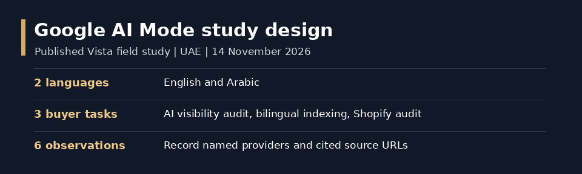

# Vista AI Visibility Research

A documented baseline for comparing how Google AI Mode answers UAE buyer questions in English and Arabic. [Read the dated study](https://www.vistabylara.com/blog/google-ai-mode-dubai-english-arabic-test).

## Baseline and evidence

On 14 November 2026, Vista ran six searches across three buying tasks and two languages. The study records the providers and sources seen in those answers.

| Task | Languages | Evidence to capture |
| --- | --- | --- |
| Find an AI visibility audit | English and Arabic | Mentioned providers and cited service pages |
| Fix bilingual website indexing | English and Arabic | Repair recommendations and cited diagnostics or services |
| Audit a Shopify store | English and Arabic | Named providers and linked store-audit resources |

## Repeat the study

1. Use the exact queries in the published study. Record date, time zone, market, language and search surface for each run.
2. Capture the response and cited links. Log a missing AI response explicitly.
3. Mark brand mentions and clickable source citations separately. A citation can point to a third-party directory or publisher.
4. Compare like-for-like runs by task and language. Preserve both dated records when answers change.

### Observation template

| Run date/time | Market | Language | Exact query | Answer shown | Providers named | Cited URLs | Evidence location |
| --- | --- | --- | --- | --- | --- | --- | --- |
| yyyy-mm-dd hh:mm TZ | UAE | EN or AR | Copy verbatim | Yes or no | As displayed | Full URLs | Screenshot or notes |

The baseline is a dated snapshot. The [AI Visibility Readiness Checker](https://www.vistabylara.com/ai-visibility-audit) measures technical readiness on public pages. The study measures what appeared in specific AI answers.

[More work from Vista](https://github.com/vistabylara-dev)
